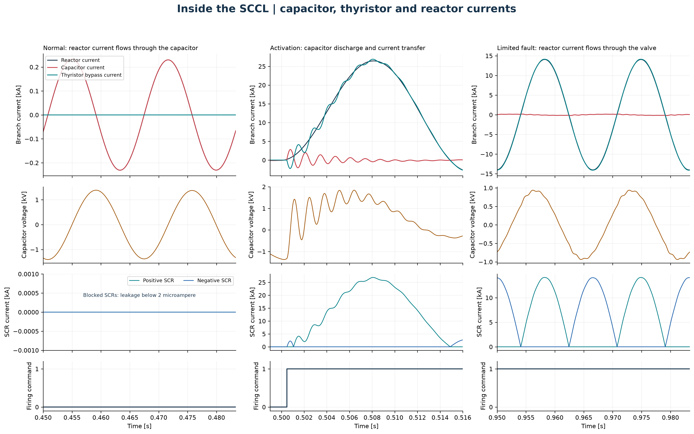
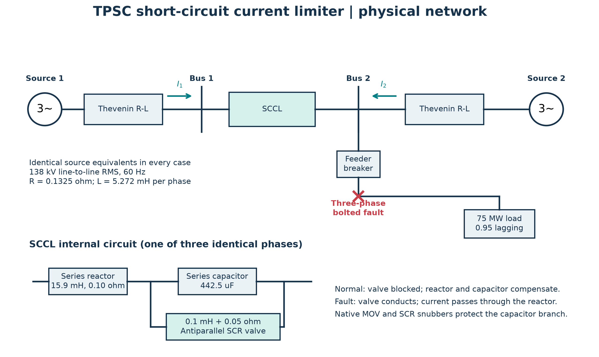
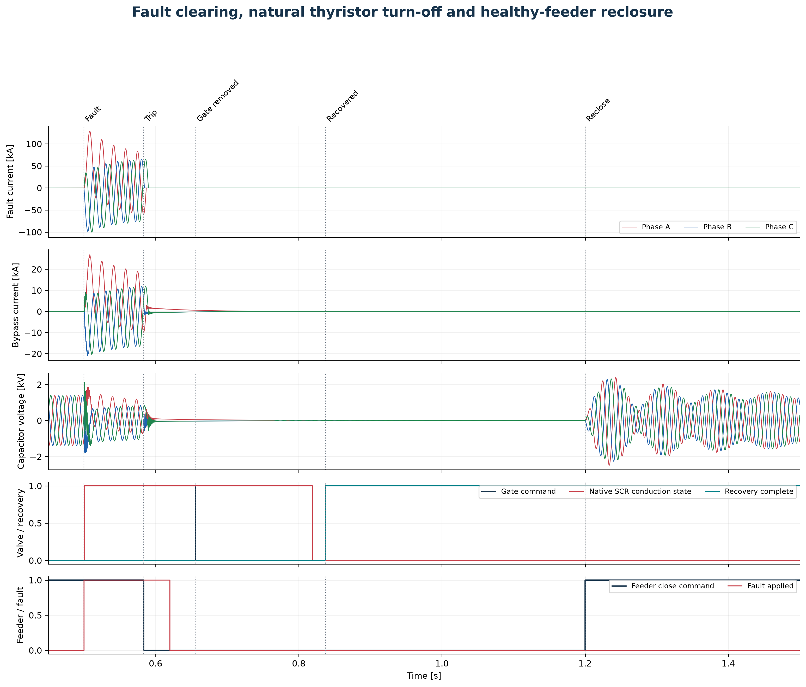
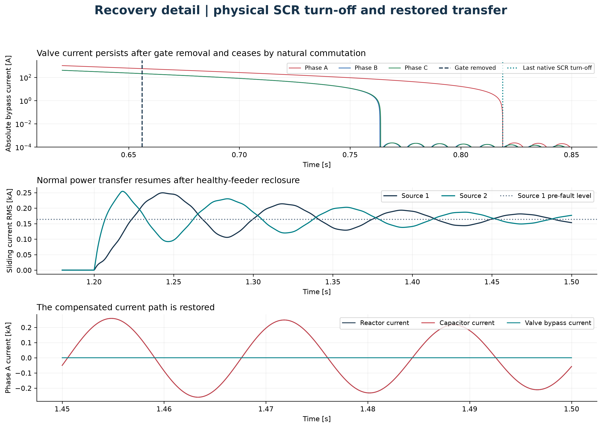
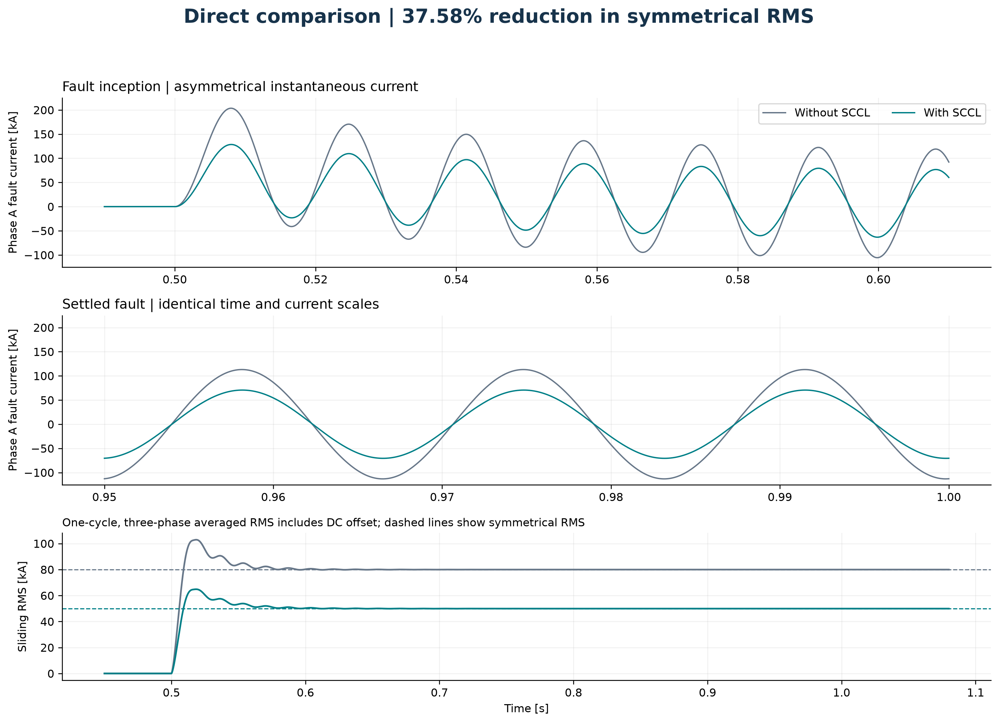
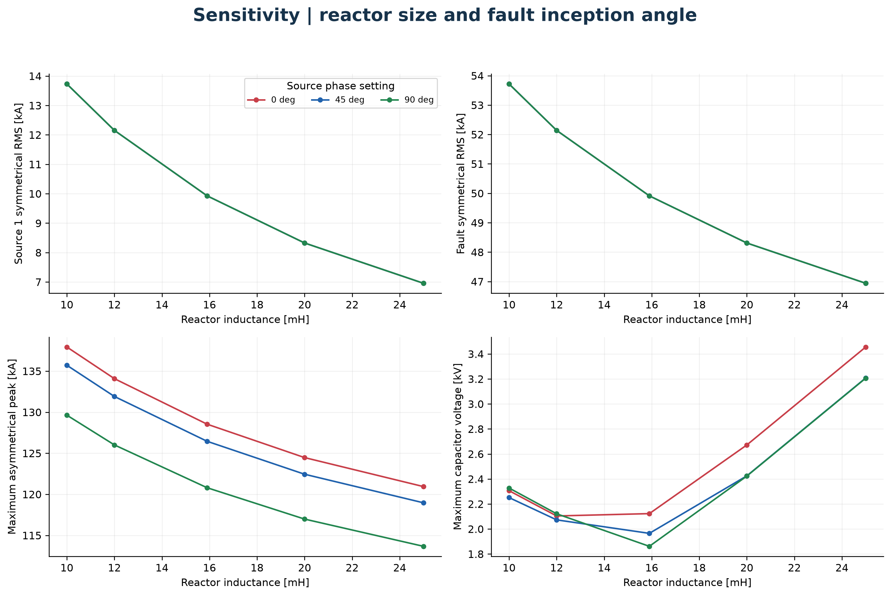

# TPSC and Series-Reactor Short-Circuit Current Limiter

## 1. Objective and verified outcome

This study uses the native PSCAD 5.1 EMTDC engine to demonstrate a three-phase 138 kV, 60 Hz short-circuit current limiter. All network currents, internal capacitor and valve currents, voltages, and device switching timestamps come from actual electrical branches. Python generates the native projects and processes EMTDC output files; it does not synthesize the study waveforms.

| Quantity | Without SCCL | With SCCL | Unit |
| --- | --- | --- | --- |
| Source 1 symmetrical RMS | 39.9759 | 9.9272 | kA |
| Source 2 symmetrical RMS | 39.9847 | 39.9910 | kA |
| Total fault symmetrical RMS | 79.9590 | 49.9135 | kA |
| Maximum asymmetrical fault peak, any phase | 203.5578 | 128.5346 | kA |
| Reduction in total symmetrical RMS | 0.0000 | 37.5762 | % |

The unchanged two-source network produces the requested approximately 80 kA versus 50 kA comparison. The nominal limited total differs from 50 kA by -0.173%. Source 1 differs from 10 kA by -0.728%. Source 2 remains approximately 40 kA. These are fundamental symmetrical RMS quantities, not instantaneous peaks.

## 2. Operating principle

During normal operation, each phase carries current through a real reactor and a real capacitor. The six SCRs are blocked. The nominal reactances at 60 Hz are XL = 5.994159 ohm and XC = 5.994536 ohm. Their cancellation leaves the winding resistance, capacitor ESR and small residual reactance. The measured normal SCCL voltage drop is 0.0224% of nominal phase voltage.

A measured overcurrent or capacitor overvoltage latches the protective bypass. Both antiparallel SCR gates are enabled. Only the forward-biased device conducts; the opposite device takes over with the appropriate polarity. The capacitor is bypassed through the discharge-limiting R-L branch and SCR valve, while the main reactor stays in the Source 1 fault-current path. Source 2 connects directly to Bus 2 through its original Thevenin impedance.

This is protective TPSC operation. There is no TCSC firing-angle regulator and no continuously controlled reactor branch across the capacitor. The small valve-branch inductance limits capacitor discharge and is not the principal fault-current limiting reactor.

## 3. Electrical network and parameters

Two native three-phase sources each include the specified series resistance and an external, visible phase inductance. The three feeder breaker poles receive a common command but each interrupts at its physical current zero. The three fault branches and modest R-L load lie downstream of the feeder breaker. There is no additional line impedance used to tune the current target.

| Parameter | Value | Unit | Basis |
| --- | --- | --- | --- |
| Nominal source voltage | 138 | kV line-line RMS | Specified |
| Frequency | 60 | Hz | Specified |
| Each source resistance | 0.1325 | ohm/phase | Specified equivalent |
| Each source inductance | 5.272 | mH/phase | Specified equivalent |
| Baseline interconnection | 0.001 ohm + 1 uH | per phase | Short busbar assumption |
| Main reactor | 15.9 mH + 0.10 ohm | per phase | Specified initial design |
| Series capacitor | 442.5 | uF/phase | Specified; exact compensation is 442.527881 uF |
| Capacitor ESR | 0.002 | ohm/phase | Equivalent bank-loss assumption |
| Bypass discharge limiting branch | 0.1 mH + 0.05 ohm | per phase | Damping and di/dt assumption |
| Each equivalent SCR stack ON/OFF resistance | 0.002 / 1e9 | ohm | Assumed linear conduction / blocking |
| SCR forward trigger threshold | 0.02 | kV | Assumed equivalent stack; native switch model |
| SCR forward breakover / reverse withstand | 100 / 100 | kV | Conservative assumed stack limits |
| SCR minimum extinction time | 100 | us | Assumption; no reverse-recovery charge model |
| Each SCR RC snubber | 1000 ohm + 0.02 uF | series RC | Assumed equivalent stack |
| MOV reference voltage / parallel stacks | 15 / 1 | kV / count | Native default nonlinear curve, scaled |
| Fault resistance | 0.005 | ohm/phase | Low finite resistance for bolted-fault approximation |
| Feeder breaker closed/open resistance | 0.0001 / 1e10 | ohm | Zero-current interruption, no arc model |
| Load | 75 MW, 0.95 lagging | at 138 kV | Constant-impedance grounded-wye R-L load |
| Pickup current / capacitor voltage | 2 / 18 | kA peak / kV peak | Configurable engineering protection assumptions |
| Gate delay | 0.1 | ms | Configurable intentional firing delay |
| MOV energy interlock | 5000 | kJ per phase | Assumed screening limit, not a thermal rating |
| Recovery permissive | 0.8 kA for 20 ms | peak / hold time | Requires all feeder poles open and no energy lockout |
| Integration / output interval | 10 / 10 | us | 5 us independent sensitivity runs |
| Source energization ramp | 0.05 | s | Startup ramp only; no fault-time voltage changes |

The sources have fixed equal magnitudes and equal relative phase. The common source phase is varied only in the inception-angle study. L and C can be edited separately in every phase. Source startup ramping ends well before the fault. The reactor is treated as an air-core linear inductance; core saturation is not assumed.

## 4. Analytical Thevenin reference

The phase RMS source voltage is E = 138/sqrt(3) = 79.674337 kV. The source impedance is Zs = 0.1325 + j1.987497 ohm, with X/R approximately 15. The load is a constant impedance Zload = VLL^2 / (P - jQ); P = 75 MW and Q = P tan(acos(0.95)).

With the capacitor bypassed, the first-order SCCL impedance is Zdevice = (0.10 + 0.05 + 0.002) + j omega (0.0159 + 0.0001) ohm. The small remaining capacitor admittance and SCR threshold effects are represented by EMTDC, rather than this first-order expression. The baseline busbar impedance is 0.001 + j omega 1e-6 ohm.

For common equal source phasors, with Y1 = 1/(Zs + Zdevice), Y2 = 1/Zs and Rf including the closed feeder breaker, Vf = E(Y1 + Y2)/(Y1 + Y2 + 1/Rf). Then I1 = (E - Vf)Y1, I2 = (E - Vf)Y2, and Itotal = I1 + I2. The analytical reference neglects the very small load current at the depressed fault voltage; the EMTDC fault meter excludes that load current exactly.

The computed references are 79.9607 kA without SCCL and 49.9143 kA with SCCL, including 9.9270 kA from Source 1 and 39.9911 kA from Source 2. RMS magnitudes are not added arithmetically. The approximately 1.8 degree difference between the two limited-current contribution phasors produces a small but real difference between their scalar sum and the magnitude of their phasor sum.

## 5. Reactor, capacitor and equivalent valve sizing

Compensation follows L = 1/(omega^2 C). The specified 442.5 uF is within 0.007% of exact compensation for 15.9 mH. At 1 kA RMS, the main reactor exchanges approximately 17.982 MVAr three-phase and the capacitor exchanges approximately 17.984 MVAr with opposite sign. The actual Source 1 pre-fault current is 0.1644 kA; its measured operating point corresponds to approximately 0.486 MVAr in each compensated element. Consequently the 1 kA example is a rating illustration, not the simulated pre-fault current.

The bypass contains 0.1 mH and 0.05 ohm before the antiparallel valve. Its capacitor-discharge natural frequency is approximately 756.6 Hz, well above the 60 Hz power frequency. It prevents an ideal short across stored capacitor energy and damps the discharge oscillation visible in Figure 5. Main-reactor current remains continuous as branch currents redistribute.

The native SCR model includes blocking, a forward trigger threshold, ON resistance, finite minimum extinction time, protective breakover, and current-zero turn-off. It does not allow a gate command to forcibly open a conducting SCR. The ON-state conduction characteristic is the native piecewise resistive equivalent, not a manufacturer semiconductor loss curve. The interpretation follows the [PSCAD thyristor documentation](https://www.pscad.com/webhelp-pscad-v5.1.0-ol/Master_Library_Models/HVDC_and_FACTS/PE_Switch/Thyristor.htm).

The native MOV uses its documented default nonlinear curve, scaled to a 15 kV reference. Its first tabulated point is 1 A at 1.1 times the reference, or 16.5 kV; 10 A corresponds to 24 kV. The selected voltage is well above the simulated normal capacitor voltage. Native low-voltage extrapolation gives a small leakage current; the measured pre-fault maximum is 0.0862 A, and the main scenarios do not require strong MOV clamping. These are engineering equivalent parameters, not verified manufacturing ratings. Electrical I-squared-t, peak voltage/current and absorbed energy are provided; junction temperature and cooling times are not calculated.

| Measured electrical stress, maximum across phases/devices | Case B | Case C | Unit |
| --- | --- | --- | --- |
| Capacitor voltage | 2.1228 | 2.4833 | kV peak |
| MOV terminal voltage including capacitor ESR | 2.1226 | 2.4833 | kV peak |
| MOV current | 0.1286 | 0.1505 | A peak |
| MOV absorbed energy | 0.04540 | 0.05348 | kJ per phase |
| SCR terminal voltage | 1.7913 | 2.4833 | kV peak |
| Valve bypass current | 26.9063 | 26.9063 | kA peak |
| Individual SCR current-squared integral | 42.7125 | 13.9250 | kA^2 s |

Stress maxima cover the complete 0-1.50 s simulation, including energization, fault clearing and recovery. The MOV terminal voltage is calculated from its measured capacitor voltage plus the measured capacitor current times the physical 0.002 ohm ESR. All per-case stresses, including the sensitivity variants, are recorded in `results/metrics.json`.

## 6. Protection, switching and recovery

Protection monitors all three Source 1 currents, all three capacitor voltages, a one-cycle three-phase mean-square RMS estimate, and per-phase MOV energy. Instantaneous pickup avoids a full-cycle detection wait. Pickup is armed after 0.15 s to exclude the deliberate source energization ramp. Thresholds and timing are visible constants in the native protection block and are also listed in `config/parameters.json`.

The nominal measured detection delay is 0.370 ms and the first effective bypass response is 0.480 ms from actual fault application. The controller supplies continuous protective gate enable rather than firing-angle modulation. Device polarity and latching are decided by the native electrical SCRs.

Recovery requires all feeder poles to be open, low SCCL current for 20 ms, acceptable capacitor voltage and no MOV energy lockout. Gate withdrawal then permits natural current-zero turn-off. Recovery-ready additionally requires valve current below 1 A and acceptable voltage for 20 ms. Independent native turn-on/turn-off timestamps verify that all six SCRs have actually turned off before recovery-ready and remain off through reclosure. Excess MOV energy latches a feeder trip and blocks recovery/reclosure. Capacitor overvoltage reasserts protective bypass.

## 7. Scenarios and actual event times

Cases A and B use matched sustained faults from 0.50 s to the feeder opening command at 1.10 s. The fault path is removed at 1.15 s after isolation. This provides a settled six-cycle measurement window from 0.95 to 1.05 s. Case C uses the requested five-cycle opening command at 0.583333 s, fault removal at 0.62 s, and healthy-feeder reclosure at 1.20 s. Actual pole interruption follows current zeros, so it occurs a few milliseconds after the opening command.

| Case C event | Measured time (s) |
| --- | --- |
| Fault applied | 0.500010 |
| Detection | 0.500380 |
| Gate enabled | 0.500480 |
| All feeder poles open | 0.589940 |
| Gate removed | 0.656060 |
| Last native SCR turn-off | 0.818909297 |
| Recovery ready | 0.837600 |
| Reclosure command | 1.200000 |

Gate removal precedes the last actual SCR turn-off by 162.85 ms. The residual circulating current decays through physical resistances; it is not forced to zero by the controller. Small load-reconnection RLC oscillations decay after 1.20 s and remain visible in sliding RMS at the 1.50 s simulation endpoint. Source 1 reaches 0.1626 kA fundamental RMS in the 1.40-1.49 s window, compared with 0.1644 kA before the fault. This demonstrates stable recovery of the normal current path; it does not imply that every transient has fully settled by 1.50 s.

## 8. Measurement definitions and provenance

The principal 80/50 kA comparison uses a least-squares 60 Hz RMS phasor over the same 0.95-1.05 s window. The sliding RMS channels are the square root of a one-cycle average of the mean of the three squared phase currents; they include transient DC offset. Instantaneous peak means the maximum absolute sample of any fault-current phase between inception and the opening command. The finite five-cycle Case C estimate fits a sinusoid, a constant and two exponential DC modes from the coupled two-source R-L network over 0.54-0.58 s. This remains an engineering approximation to the switched circuit; the main acceptance comparison relies on the longer settled A/B window.

Every run has a timestamped directory, source `.pscx` snapshot, `.inf` channel map, original `.out` files, generated Fortran/build evidence, and SHA-256 run receipt. `results/selected_runs.json` selects the accepted runs. Native `.inf` PGB indices determine the data columns; all OUT block time vectors are checked. `waveforms.npz` is a lossless numerical convenience copy of those native files.

Positive I1 and I2 point toward Bus 2; positive IF and ILOAD point into their downstream branches. Thus the exact conservation equation is I1 + I2 = IF + ILOAD. Finite fault resistance leaves a very small load current during the fault, which is retained rather than silently assigned to the fault meter. Internal conservation is I1 = IC + IV - IM because the native arrester current output uses the opposite reference direction. `VL` measures the reactor assembly including winding resistance; `VC` measures the capacitor itself; `VDROP` measures the full SCCL. `VS1/VS2` are the source-component terminal voltages before their external Thevenin inductors, and `VB1/VB2` are the resulting bus voltages.

Dedicated source ammeters and post-network-solution measurement processing keep the principal branch currents on the same EMTDC time level. There is no waveform time shifting or amplitude scaling to obtain current balance. The reason for explicit output ordering is explained in [PSCAD's DSDYN/DSOUT documentation](https://pscad.com/webhelp-v502-ol/EMTDC/Program_Structure/dsdyn_and_dsout_subroutines.htm). Native SCR timestamp channels retain the event time reported by the solver; effective 1 A conduction monitoring is distinguished from native device state.

## 9. Comparison with the supplied references

`Short-Circuit-Current-Limiter.png` supplies the capacitor-only bypass plus main reactor relationship. The order of series capacitor and reactor does not change this single-branch circuit principle; the native study places the reactor before the protected capacitor for readable wiring. `Results-Measurments.png` supplies the two-source arrangement and approximate RMS target levels. The original image contains no digitized waveform samples, so the comparison is topology- and magnitude-based, not a claim of exact sample equivalence.

`Screenshot 2026-11-03 094514.png` motivates fault clearing, valve release, dead time and reclosure. Its optional mechanical capacitor-bypass breaker and absolute thermal curves are not reproduced. This implementation demonstrates the requested SCR-only capacitor bypass and natural electrical recovery directly, using a physical feeder breaker. No claim is made about the illustrated 260 C temperature or multi-hour cooling times.

## 10. Inductance, capacitance and inception-angle sensitivity

The main matrix has five inductances and three common source phase settings. C is retuned for 60 Hz compensation except that the specified 442.5 uF is retained at 15.9 mH. Source equivalents, load, fault resistance and timing are unchanged. Changing the common source phase changes the voltage point on wave at fixed fault time without introducing a relative phase shift between sources.

| L (mH) | C (uF) | Source 1 RMS (kA) | Fault RMS (kA) | Reduction (%) | Fault peak (kA) | Reactor peak voltage (kV) | Capacitor peak voltage (kV) | Valve peak (kA) |
| --- | --- | --- | --- | --- | --- | --- | --- | --- |
| 10.0 | 703.619 | 13.730 | 53.717 | 32.82 | 137.93 | 74.70 | 2.306 | 36.324 |
| 12.0 | 586.349 | 12.152 | 52.139 | 34.79 | 134.08 | 79.28 | 2.104 | 32.296 |
| 15.9 | 442.500 | 9.927 | 49.913 | 37.58 | 128.53 | 85.66 | 2.123 | 26.906 |
| 20.0 | 351.810 | 8.325 | 48.310 | 39.58 | 124.47 | 90.20 | 2.672 | 22.748 |
| 25.0 | 281.448 | 6.955 | 46.941 | 41.29 | 120.94 | 94.08 | 3.455 | 19.234 |

At nominal L, the inception-angle results are:

| Source phase setting (deg) | Phase A fault peak (kA) | Worst phase fault peak (kA) | Detection delay (ms) | First bypass response (ms) |
| --- | --- | --- | --- | --- |
| 0 | 128.535 | 128.535 | 0.370 | 0.480 |
| 45 | 111.257 | 126.451 | 0.350 | 0.460 |
| 90 | 73.451 | 120.798 | 0.340 | 0.450 |

The worst three-phase peak is the maximum over all phase peaks; it is less angle-sensitive than Phase A alone because another phase can become the worst phase. The full matrix, including every stress and result folder, is in `results/metrics.json`.

The independent-parameter teaching cases retain C = 442.5 uF:

| L (mH) | Fixed C (uF) | Pre-fault Source 1 RMS (kA) | Normal SCCL voltage drop (%) | Fault RMS (kA) | Capacitor peak (kV) |
| --- | --- | --- | --- | --- | --- |
| 10.0 | 442.5 | 0.3647 | 1.014 | 53.717 | 4.382 |
| 25.0 | 442.5 | 0.0886 | 0.381 | 46.941 | 2.149 |

Increasing L reduces the Source 1 fault contribution, but requires smaller C for equal 60 Hz compensation and increases the reactor voltage duty and magnetic energy. At a fixed normal current, reactor and capacitor reactive ratings rise with L. Leaving C unchanged alters normal transfer sharing, residual reactive voltage drop, natural frequencies and switching stress. A low fault current alone is therefore insufficient for selecting an acceptable SCCL design.

## 11. Numerical verification and limitations

The accepted checks currently pass 332/332; see `validation_report.md` for exact assertions and convergence values. Both network and SCCL branch KCL are checked at every saved time step. The switching transition energy check uses the measured SCCL input power, main-reactor and bypass-reactor magnetic energy, capacitor electric energy, winding/ESR/bypass losses, native switch-plus-snubber terminal power and MOV power. Its nominal worst relative residual is 0.00267% of maximum stored energy in the 0.49-0.56 s interval. This checks the electrical energy accounting; it is not a semiconductor thermal validation.

The 10 us runs are compared with independent 5 us runs for all three principal cases. Numerical integration, output intervals and native switch interpolation are recorded in each receipt. Peak sensitivity and capacitor/valve stress are checked in addition to RMS current. The finite native MOV approximation and switching event interpolation can leave milliamperes of instantaneous internal KCL residual; the acceptance bound is 1 A against kiloampere currents.

Limitations: linear Thevenin sources and air-core reactors; balanced three-phase faults only; no frequency-dependent line, transformer saturation, generator subtransient decay, breaker arc/TRV withstand model, failed-reclosure study, semiconductor reverse-recovery charge, manufacturing coordination study or thermal network. Equivalent SCR/snubber/MOV values are transparent assumptions. No standards compliance or certified equipment rating is claimed. There is a configurable 100 us SCR extinction-time assumption, and the native resistive switch characteristic cannot establish detailed switching losses or junction temperatures.

## 12. Engineering conclusion

The actual electrical network reproduces the requested current reduction with identical source equivalents: approximately 79.96 kA to 49.91 kA symmetrical RMS. The capacitor provides low normal series reactance, and its protective SCR bypass exposes the main reactor during the fault. Current division follows the physical source and branch impedances. Natural valve turn-off, capacitor reinsertion and healthy-feeder reclosure are demonstrated without forcibly opening an SCR.

The native editable projects, visible wiring, configurable controls, raw EMTDC outputs, generated analysis, figures, and verified packages provide an auditable educational study. The supplied reference images are preserved unchanged.

## Implementation references

- [PSCAD Automation Library overview](https://www.pscad.com/software/pscad/automation-library)
- [Application API](https://www.pscad.com/webhelp-v501-al/reference/pscad.html)
- [Project API](https://www.pscad.com/webhelp-v501-al/reference/project.html)
- [Component API](https://www.pscad.com/webhelp-v501-al/reference/component.html)
- [Component Wizard](https://www.pscad.com/webhelp-v501-al/reference/wizard.html)
- [Native Power Electronic Switch](https://www.pscad.com/webhelp-pscad-v5.1.0-ol/Master_Library_Models/HVDC_and_FACTS/PE_Switch/peswitch.htm)

Installed execution environment: PSCAD 5.1.0 Professional, licensed native EMTDC, GFortran 8.1 (64-bit), Python 3.11 and mhi.pscad 3.1.2. Actual local API signatures and Master Library port definitions were inspected before generation.
